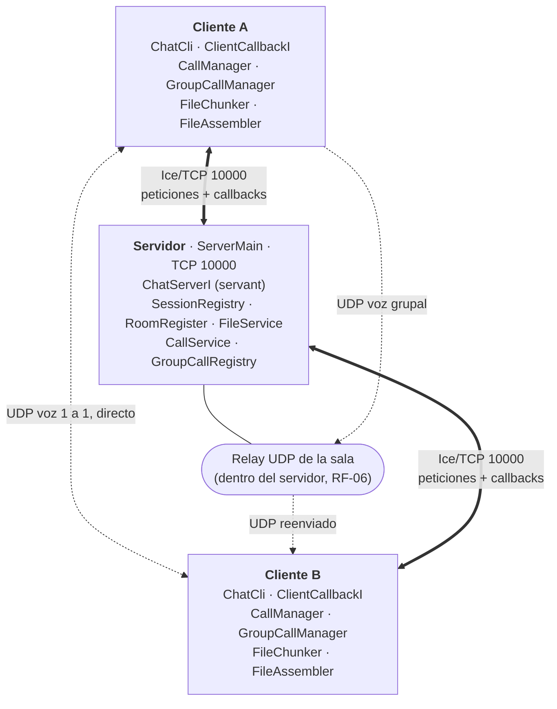
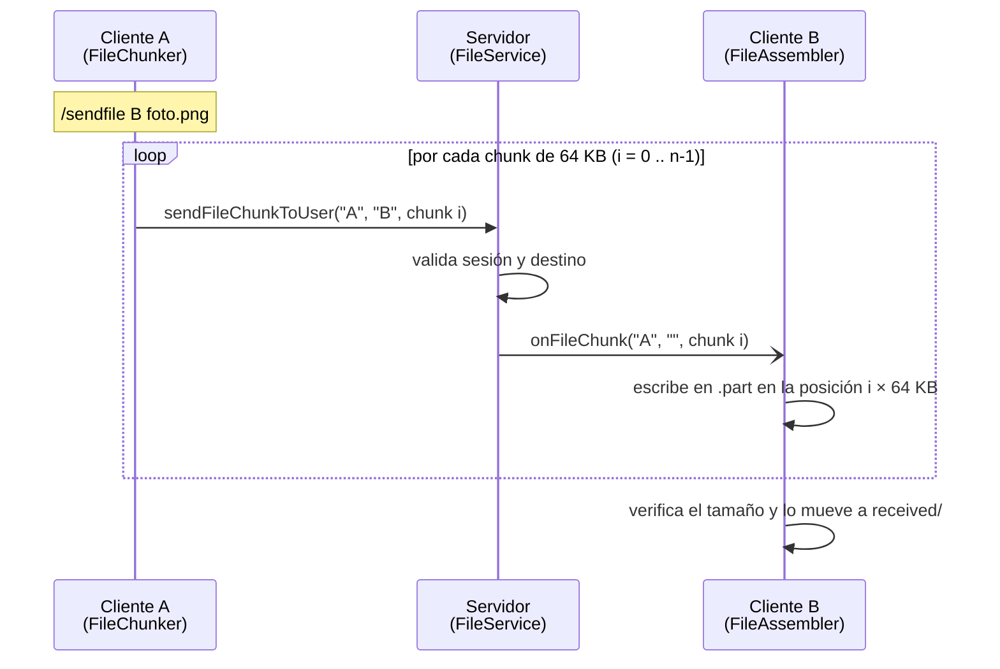
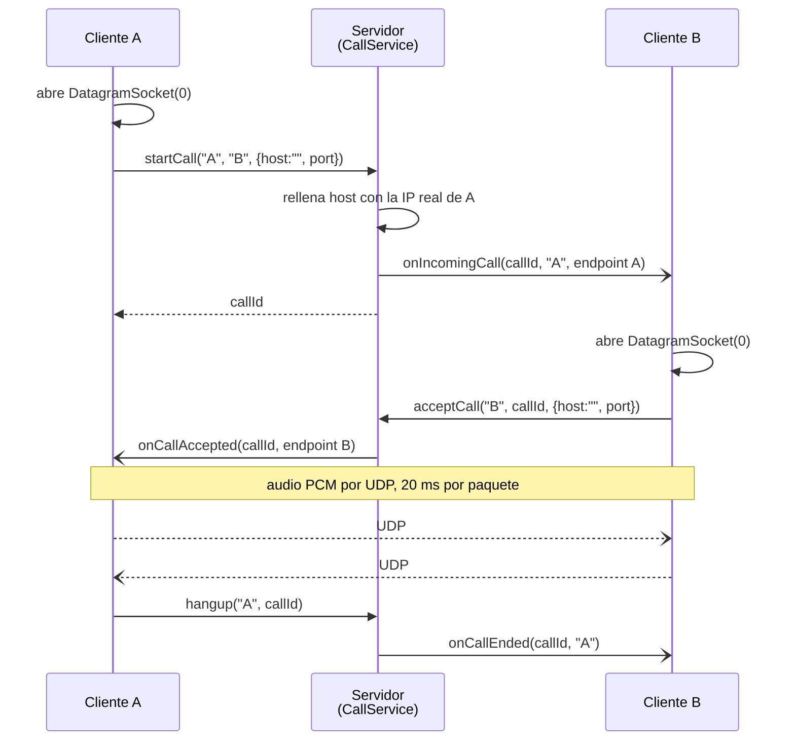
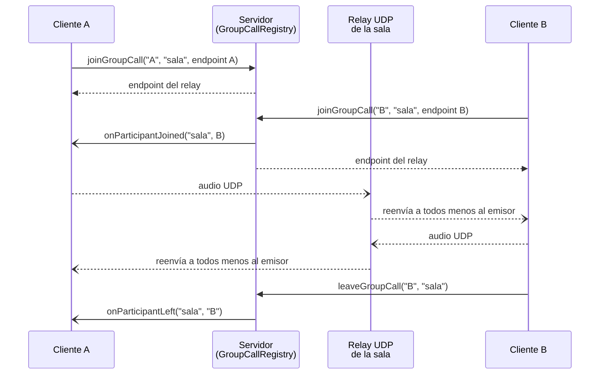

# Chat Multimedia Distribuido con ZeroC Ice y Voz UDP

Sistema de chat multiusuario por consola, tipo Discord, construido como proyecto Gradle multimódulo con el middleware **ZeroC Ice 3.7** (RPC sobre TCP) para sesión, mensajes, salas, archivos y señalización de llamadas, y **UDP directo** para la voz. Computación en Internet I — Universidad Icesi.

**Integrantes**

| Integrante | Código | Requerimientos |
|---|---|---|
| Juan Diego Domínguez | A00411836 | RF-01 Sesión y presencia · RF-02 Mensajes privados |
| Emmanuel Muñoz | A00410447 | RF-03 Salas · RF-06 Llamada grupal |
| Andrés Felipe García | A00410510 | RF-04 Archivos · RF-05 Llamada 1 a 1 |

## Tabla de contenido

- [Estructura del proyecto](#estructura-del-proyecto)
- [Requisitos](#requisitos)
- [Compilar](#compilar)
- [Ejecutar](#ejecutar)
- [Arquitectura](#arquitectura)
- [Manual de usuario](#manual-de-usuario)
- [Herramientas de prueba](#herramientas-de-prueba)
- [Problemas comunes](#problemas-comunes)
- [Documentación adicional](#documentación-adicional)

## Estructura del proyecto

El proyecto Gradle está en `Imple/Discord_ICE`:

```text
Imple/Discord_ICE
├── common/   contrato Slice (src/main/slice/Chat.ice); de aquí slice2java genera el código Java compartido
├── server/   servidor Ice (puerto 10000) + config.server
│   └── chat/server
│       ├── ServerMain          arranca el Communicator y el ObjectAdapter
│       ├── ChatServerI         servant: implementa la interfaz ChatServer y delega en los servicios
│       ├── SessionRegistry     RF-01: sesiones, callbacks, presencia y detección de caídas
│       ├── RoomRegister        RF-03: salas y miembros
│       ├── FileService         RF-04: reenvío de chunks a un usuario o a una sala
│       ├── CallService         RF-05: señalización de llamadas 1 a 1
│       └── GroupCallRegistry   RF-06: llamadas grupales y relay UDP por sala
└── client/   cliente de consola + config.client
    └── chat/client
        ├── ClientMain          CLI (hilo de teclado) y conexión con el server
        ├── ClientCallbackI     objeto que el server invoca de vuelta (callbacks)
        ├── CallManager         RF-05: estado de la llamada 1 a 1 y audio
        ├── GroupCallManager    RF-06: estado de la llamada grupal y audio hacia el relay
        ├── audio/              AudioSender (micrófono → UDP), AudioReceiver (UDP → parlante)
        └── files/              FileChunker (parte en chunks), FileAssembler (rearma)
```

## Requisitos

- **JDK 17** o superior.
- **ZeroC Ice 3.7.11**: el compilador `slice2java` tiene que estar en el PATH. Para verificarlo: `slice2java --version`.
- No hace falta instalar Gradle: se usa el wrapper (`gradlew`, Gradle 8.14).
- Para las llamadas: micrófono y parlantes/audífonos.

> El código generado por Slice no se sube al repositorio; se regenera en cada build. Por eso Ice debe estar instalado en cada máquina que compile el proyecto.

## Compilar

Desde la carpeta del proyecto Gradle:

```powershell
cd Imple/Discord_ICE
.\gradlew clean build
```

Debe terminar en `BUILD SUCCESSFUL`. El build ejecuta `compileSlice` (genera el Java a partir de `Chat.ice`), compila los tres módulos y corre las pruebas JUnit del server.

> En Windows se usa `.\gradlew`; en Linux/Mac, `./gradlew`.

## Ejecutar

Se abre una terminal por proceso, siempre ubicados en `Imple/Discord_ICE`.

**1. Servidor** (un solo PC):

```powershell
.\gradlew :server:runServer
```

Lee `server/config.server`: escucha en `tcp -p 10000` en todas las interfaces y usa un ThreadPool de 4 a 16 hilos.

**2. Clientes** (uno por usuario, en el mismo PC o en otros):

```powershell
.\gradlew :client:runClient -Pserver=<IP del servidor>
```

| Parámetro | Para qué | Por defecto |
|---|---|---|
| `-Pserver=<ip>` | IP del PC donde corre el server | `localhost` |
| `-Pport=<puerto>` | Puerto del server | `10000` |

### Varios PCs en la misma red

La **única IP que se escribe a mano es la del servidor**. Las IPs para el audio no se configuran: el server toma la IP real de cada cliente de su conexión TCP y se la pasa a los demás.

1. En el PC servidor, ver la IP con `ipconfig` (por ejemplo `192.168.1.16`).
2. Probar desde los otros PCs que se vean: `ping 192.168.1.16`.
3. Levantar el server en ese PC y todos los clientes con `-Pserver=192.168.1.16`.

> **Importante:** el cliente que corre en el mismo PC del servidor también debe usar `-Pserver=192.168.1.16` y **no** `localhost`. Si entra por `localhost`, el server ve su IP como `127.0.0.1`, se la pasa a los demás y el audio nunca les llega.

**Firewall (Windows):** marcar la red como **privada**, dejar el firewall activado y, cuando Windows pregunte, **permitir Java**. Se necesita que entre TCP 10000 en el PC servidor y UDP en los clientes (y en el servidor para la llamada grupal). Los puertos UDP los asigna el sistema operativo en cada llamada.

## Arquitectura

El sistema separa dos tipos de tráfico:

| Canal | Protocolo | Qué viaja | Por qué |
|---|---|---|---|
| **Ice** | TCP, puerto 10000 | login, presencia, mensajes privados y de sala, chunks de archivos, señalización de llamadas (llamar, aceptar, rechazar, colgar, unirse) | necesita entrega confiable y en orden |
| **Voz** | UDP | audio PCM 16 kHz, 16 bits, mono, en paquetes de 20 ms (640 bytes, 50 por segundo) | en voz es mejor perder un paquete que esperar a que se reenvíe tarde |

### Diagrama general



Líneas gruesas = Ice sobre TCP (peticiones del cliente y callbacks del servidor por la misma conexión). Líneas punteadas = voz sobre UDP: en la llamada 1 a 1 el audio va directo entre clientes; en la grupal pasa por el relay que el servidor abre por sala.

### Flujo de Ice: callbacks bidireccionales

Cada cliente abre **una sola conexión TCP** al servidor y la usa en los dos sentidos:

- **Cliente → Servidor:** el cliente llama operaciones de `ChatServer` (`login`, `sendPrivate`, `sendToRoom`, `sendFileChunkToUser`, `startCall`, `joinGroupCall`...).
- **Servidor → Cliente:** en el `login` el cliente le pasa al server el proxy de su `ClientCallback`. El cliente crea su adaptador **sin endpoints** (`createObjectAdapter("")`) y lo amarra a la conexión (`connection.setAdapter(adapter)`), así el server le habla por esa misma conexión (`onUserJoined`, `onPrivateMessage`, `onRoomMessage`, `onFileChunk`, `onIncomingCall`...). El cliente no abre puertos, lo que evita problemas con NAT y firewall.

El server invoca los callbacks de forma **asíncrona** (`...Async`) para que un cliente lento no bloquee a los demás. Con **ACM** el cliente manda heartbeats cada 10 s y el server cierra las conexiones que pasan 30 s sin actividad; cuando una conexión se cierra, se limpia la sesión, se avisa a los demás y se terminan las llamadas en curso de ese usuario.

### Flujo de archivos (RF-04)

Los archivos viajan por Ice partidos en bloques de **64 KB** (`FileChunk` con `transferId`, nombre, tamaño total, índice, total de chunks y `data` como `sequence<byte>`), muy por debajo del límite por defecto de Ice (`Ice.MessageSizeMax` = 1 MB). El servidor solo hace de cartero: no arma ni guarda archivos.



En una sala (`/sendfileroom`) el cliente llama `sendFileChunkToRoom`; el server valida que la sala exista y que el emisor sea miembro, y reenvía cada chunk a todos los miembros menos al emisor, con el nombre de la sala.

### Flujo de voz 1 a 1 (RF-05)

La señalización va por Ice y el audio va **directo entre los dos clientes** por UDP.



El cliente manda el host vacío y el server lo completa con la IP de la conexión TCP, por eso nadie tiene que escribir IPs para el audio. Si el destino ya está en otra llamada, el server responde `UserBusy`.

### Flujo de voz grupal (RF-06, relay)

En la llamada grupal cada cliente le manda su audio a un **relay UDP** que el servidor abre por sala, y el relay lo reenvía a los demás participantes. Así cada cliente envía un solo flujo, sin importar cuántos haya en la llamada.



## Manual de usuario

Al iniciar, el cliente pide un **nickname** (no puede estar vacío, tener espacios ni estar en uso). Después se escriben comandos; `/help` los muestra todos.

> Los comandos distinguen mayúsculas: se escriben exactamente como en la tabla (por ejemplo `/createRoom`, no `/createroom`).

### Sesión y mensajes

| Comando | Qué hace |
|---|---|
| `/help` | Muestra los comandos |
| `/users` | Lista los usuarios conectados |
| `/msg <nick> <texto>` | Mensaje privado a un usuario |
| `/logout` | Cierra sesión y vuelve a pedir nickname |
| `/quit` | Cierra sesión y sale del programa |

### Salas

| Comando | Qué hace |
|---|---|
| `/createRoom <sala>` | Crea una sala; quien la crea queda adentro |
| `/rooms` | Lista las salas que existen |
| `/join <sala>` | Unirse a una sala |
| `/leave <sala>` | Salir de una sala |
| `/mesageRoom <sala> <texto>` | Mensaje a todos los miembros de la sala |

### Archivos

| Comando | Qué hace |
|---|---|
| `/sendfile <nick> <ruta>` | Envía un archivo a un usuario |
| `/sendfileroom <sala> <ruta>` | Envía un archivo a todos los miembros de una sala |

La ruta puede ser absoluta o relativa a la carpeta `client`, y puede ir entre comillas si tiene espacios. Los archivos recibidos quedan en `client/received`. Si ya existe uno con el mismo nombre, se guarda como `nombre (1).ext`.

### Llamada 1 a 1

| Comando | Qué hace |
|---|---|
| `/call <nick>` | Llama a un usuario |
| `/accept` | Contesta la llamada entrante |
| `/reject` | Rechaza la llamada entrante |
| `/hangup` | Cuelga la llamada (o la cancela si todavía está sonando) |
| `/mute` | Silencia / activa el micrófono |

### Llamada grupal

| Comando | Qué hace |
|---|---|
| `/joinCall <sala>` | Entra a la llamada grupal de una sala (hay que ser miembro) |
| `/leaveCall` | Sale de la llamada grupal |
| `/participants <sala>` | Muestra quién está en la llamada de la sala |
| `/muteCall` | Silencia / activa el micrófono en la llamada grupal |

### Ejemplo de uso

```text
Nickname: Alice
[CLIENT] Sesión iniciada como Alice. /help para ver comandos.
[CLIENT] Conectados: Alice, Bob
/msg Bob hola Bob
[19:25:03] (para Bob) hola Bob
/createRoom proyecto
[CLIENT] Sala 'proyecto' creada.
/sendfileroom proyecto "C:\Users\alice\Documents\enunciado.pdf"
[ARCHIVO] Enviando 'enunciado.pdf' a #proyecto...
[ARCHIVO] Enviado 'enunciado.pdf' a #proyecto (3 chunks, 31 ms)
/call Bob
[LLAMADA] Llamando a Bob...
[LLAMADA] Bob contestó. /mute para silenciar, /hangup para colgar.
[AUDIO] Enviando a 192.168.1.14:41777, escuchando en UDP 42221
/hangup
[LLAMADA] Colgaste.
```

### Mensajes que muestra el cliente

| Prefijo | Significado |
|---|---|
| `[+] / [-]` | Un usuario se conectó / se desconectó |
| `(privado)` / `#sala` | Mensaje recibido en privado / en una sala |
| `[ARCHIVO]` | Envío o recepción de archivos |
| `[LLAMADA]` / `[LLAMADA GRUPAL]` | Estado de las llamadas |
| `[AUDIO]` | A qué IP:puerto se manda el audio y en qué puerto UDP se escucha |
| `[CLIENT]` | Mensajes del cliente y errores controlados (sala que no existe, usuario ocupado, etc.) |

## Herramientas de prueba

Pruebas aisladas que no necesitan el servidor:

```powershell
# Audio UDP entre dos PCs (correr en los dos al tiempo, cada uno con la IP del otro)
.\gradlew :client:runAudioTest -PaudioArgs="<ip del otro PC> 5000 5000"

# Partir y rearmar un archivo en desorden, comparando el SHA-256
.\gradlew :client:runFileTest -Pfile="C:\ruta\a\archivo.pdf"
```

Pruebas JUnit del servidor (sesión y mensajes privados): `.\gradlew :server:test`.

## Problemas comunes

| Síntoma | Causa | Solución |
|---|---|---|
| `slice2java not found` al compilar | Ice no está instalado o no está en el PATH | Instalar ZeroC Ice 3.7 y verificar con `slice2java --version` |
| `[CLIENT] No se pudo conectar (::Ice::ConnectionRefusedException)` | El server no está corriendo, la IP/puerto están mal o el firewall bloquea el 10000 | Verificar el server, la IP con `ping` y el firewall |
| El chat funciona pero no se escucha el audio | Firewall bloqueando UDP, o algún cliente entró con `localhost` | Red privada + permitir Java; usar siempre la IP LAN del server |
| Errores en rojo en IntelliJ después de cambiar `Chat.ice` | El código generado quedó viejo | `.\gradlew clean build` y *Reload All Gradle Projects* |
| Tildes raras en la consola de Windows | Codificación de la consola | Ejecutar `chcp 65001` antes de correr |

## Documentación adicional

- [`docs/PreguntasTeoricas.md`](docs/PreguntasTeoricas.md): informe técnico de funcionamiento con capturas de cada prueba y respuestas a las preguntas teóricas.
- [`Imple/Discord_ICE/common/src/main/slice/Chat.ice`](Imple/Discord_ICE/common/src/main/slice/Chat.ice): contrato Slice completo (excepciones, estructuras, `ClientCallback` y `ChatServer`).
