### Juan Diego Dominguez A00411836
### Andres Felipe Garcia A00410510
### Emmanuel Muñoz A00410447

# informe técnico de funcionamiento

Aclaración importante del estado del proyecto: es un proyecto Gradle multimódulo con tres subproyectos (`common`, `server`, `client`). En `common` está el contrato `Chat.ice`, y de ahí `slice2java` genera el código Java que usan tanto el server como el cliente. Para compilarlo nos ubicamos en la raíz del proyecto, que en este caso es `Imple/Discord_ICE`, y digitamos el siguiente comando:

`.\gradlew clean build`

Igual que en el taller pasado usamos el wrapper (`.\gradlew`) y no `gradle` directo, para que todos los integrantes usemos la misma versión de Gradle (8.14) sin depender de lo que cada uno tenga instalado. En este build se dispara la tarea `compileSlice`, que invoca a `slice2java` sobre `Chat.ice`, y además corren las pruebas de JUnit del server.

Lo que está funcionando y se prueba en este documento:

| Requerimiento | Qué hace | Quién |
|---|---|---|
| RF-01 | Login, presencia en tiempo real con callbacks, `/users` | JD |
| RF-02 | Mensajes privados | JD |
| RF-04 | Envío de archivos por chunks de 64 KB (`sequence<byte>`) | Andrés |
| RF-05 | Llamada de voz 1 a 1: señalización por Ice y audio por UDP | Andrés |

RF-03 (salas) y RF-06 (llamada grupal) son de Emmanuel; cuando estén unidos en `dev` se agregan sus pruebas acá con el mismo formato.

## Funcionamiento Código

Para estas pruebas abrimos 4 terminales: una para el server y tres para los clientes (`Alice`, `Bob` y `Carlos`). Algo importante es que los clientes **no** se conectan con `localhost`, sino con la IP del equipo donde corre el server (en esta corrida `192.0.2.2`; en la prueba con dos PCs fue `192.168.1.16`). Esto es porque el server usa la IP desde la que le llega cada cliente para armar la dirección del audio de las llamadas, y si alguien entra por `localhost` el server le pasaría `127.0.0.1` a los demás y el audio nunca les llegaría.

Primero ponemos a correr el server. Nos ubicamos en la raíz del proyecto y ejecutamos:

`.\gradlew :server:runServer`

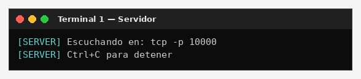

```text
[SERVER] Escuchando en: tcp -p 10000
[SERVER] Ctrl+C para detener
```

ahí el server está corriendo bien; leyó `config.server`, creó el `ObjectAdapter` con el endpoint `tcp -p 10000` (sin `-h`, o sea que escucha en todas las interfaces, que es lo que necesitamos para la demo en red) y registró el objeto con la identidad `ChatServer`. En ese mismo archivo le subimos el ThreadPool del server a 4 hilos (hasta 16), porque con callbacks un solo hilo se puede bloquear.

### Prueba 1 — Inicio de sesión y presencia (RF-01)

En una segunda terminal levantamos el primer cliente pasándole la IP del server, y en una tercera el segundo cliente:

`.\gradlew :client:runClient -Pserver=192.0.2.2`

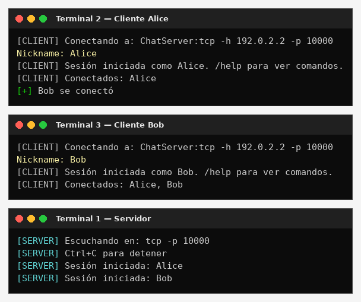

```text
--- Alice ---
[CLIENT] Conectando a: ChatServer:tcp -h 192.0.2.2 -p 10000
Nickname: Alice
[CLIENT] Sesión iniciada como Alice. /help para ver comandos.
[CLIENT] Conectados: Alice
[+] Bob se conectó

--- Bob ---
Nickname: Bob
[CLIENT] Sesión iniciada como Bob. /help para ver comandos.
[CLIENT] Conectados: Alice, Bob

--- Server ---
[SERVER] Sesión iniciada: Alice
[SERVER] Sesión iniciada: Bob
```

los dos quedaron autenticados y lo importante es la línea `[+] Bob se conectó` en la terminal de Alice: Alice no preguntó nada, fue el **server el que la llamó a ella**. Eso es el callback: en el `login` cada cliente le pasa al server su nickname y el proxy de su `ClientCallback`, y el server lo guarda para avisarle cuando pase algo. Como el cliente crea su adaptador sin endpoints (`createObjectAdapter("")`) y lo amarra a la conexión con `setAdapter`, el server le habla por la misma conexión TCP que el cliente abrió, sin que el cliente tenga que abrir puertos.

Con `/help` miramos los comandos que tiene la CLI:

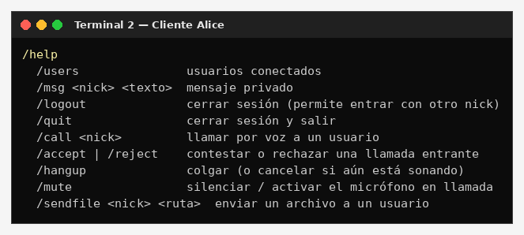

```text
  /users               usuarios conectados
  /msg <nick> <texto>  mensaje privado
  /logout              cerrar sesión (permite entrar con otro nick)
  /quit                cerrar sesión y salir
  /call <nick>         llamar por voz a un usuario
  /accept | /reject    contestar o rechazar una llamada entrante
  /hangup              colgar (o cancelar si aún está sonando)
  /mute                silenciar / activar el micrófono en llamada
  /sendfile <nick> <ruta>  enviar un archivo a un usuario
```

### Prueba 2 — Nickname repetido o vacío

Ahora en una cuarta terminal levantamos otro cliente e intentamos entrar como `Alice`, que ya está conectada, después con un nickname vacío y por último como `Carlos`:

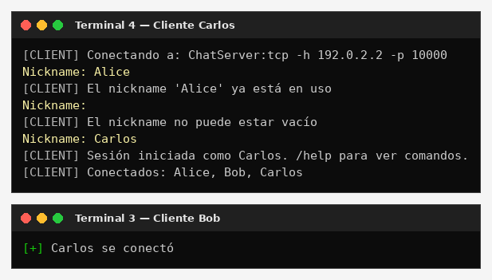

```text
Nickname: Alice
[CLIENT] El nickname 'Alice' ya está en uso
Nickname:
[CLIENT] El nickname no puede estar vacío
Nickname: Carlos
[CLIENT] Sesión iniciada como Carlos. /help para ver comandos.
[CLIENT] Conectados: Alice, Bob, Carlos
```

el server responde con las excepciones del contrato `NickNameInUse` e `InvalidNickname`, y el cliente **no se cae**: las atrapa, muestra el `reason` y vuelve a pedir nickname. Cuando Carlos entra bien, a Bob (y a Alice) les llega `[+] Carlos se conectó`.

### Prueba 3 — Mensajes privados (RF-02)

Bob le escribe a Alice con `/msg`, ella le responde, y después Bob intenta escribirle a `Pedro`, que no existe:

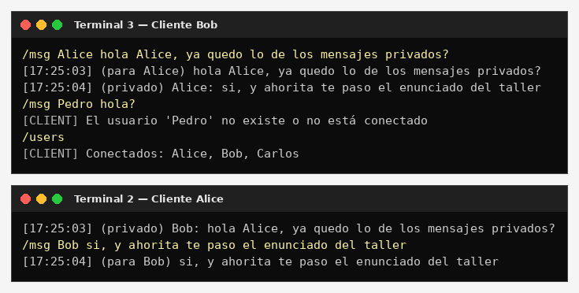

```text
--- Bob ---
/msg Alice hola Alice, ya quedo lo de los mensajes privados?
[17:25:03] (para Alice) hola Alice, ya quedo lo de los mensajes privados?
[17:25:04] (privado) Alice: si, y ahorita te paso el enunciado del taller
/msg Pedro hola?
[CLIENT] El usuario 'Pedro' no existe o no está conectado
/users
[CLIENT] Conectados: Alice, Bob, Carlos

--- Alice ---
[17:25:03] (privado) Bob: hola Alice, ya quedo lo de los mensajes privados?
/msg Bob si, y ahorita te paso el enunciado del taller
[17:25:04] (para Bob) si, y ahorita te paso el enunciado del taller
```

el mensaje le llega a Alice al instante con hora y remitente, otra vez por callback (`onPrivateMessage`). Que `sendPrivate` retorne sin excepción es la confirmación de que el server lo recibió y se lo pasó al destino; por eso Bob ve su propia línea `(para Alice)`. Cuando el destino no existe el server lanza `UserNotFound` y el cliente lo muestra sin romperse.

### Prueba 4 — Envío de archivos por chunks (RF-04)

Ahora Alice le manda a Bob dos archivos: el PDF del enunciado del taller y una imagen de 1.6 MB. También probamos un archivo que no existe y mandárselo a ella misma:

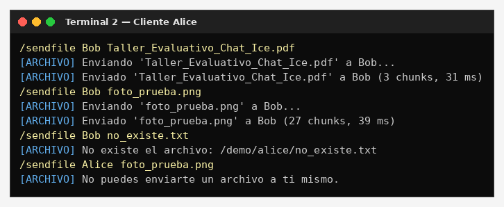

```text
/sendfile Bob Taller_Evaluativo_Chat_Ice.pdf
[ARCHIVO] Enviando 'Taller_Evaluativo_Chat_Ice.pdf' a Bob...
[ARCHIVO] Enviado 'Taller_Evaluativo_Chat_Ice.pdf' a Bob (3 chunks, 31 ms)
/sendfile Bob foto_prueba.png
[ARCHIVO] Enviando 'foto_prueba.png' a Bob...
[ARCHIVO] Enviado 'foto_prueba.png' a Bob (27 chunks, 39 ms)
/sendfile Bob no_existe.txt
[ARCHIVO] No existe el archivo: /demo/alice/no_existe.txt
/sendfile Alice foto_prueba.png
[ARCHIVO] No puedes enviarte un archivo a ti mismo.
```

y miremos qué le llega a Bob y qué registra el server:

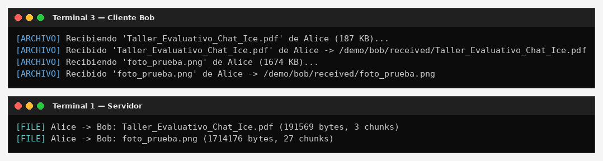

```text
--- Bob ---
[ARCHIVO] Recibiendo 'Taller_Evaluativo_Chat_Ice.pdf' de Alice (187 KB)...
[ARCHIVO] Recibido 'Taller_Evaluativo_Chat_Ice.pdf' de Alice -> /demo/bob/received/Taller_Evaluativo_Chat_Ice.pdf
[ARCHIVO] Recibiendo 'foto_prueba.png' de Alice (1674 KB)...
[ARCHIVO] Recibido 'foto_prueba.png' de Alice -> /demo/bob/received/foto_prueba.png

--- Server ---
[FILE] Alice -> Bob: Taller_Evaluativo_Chat_Ice.pdf (191569 bytes, 3 chunks)
[FILE] Alice -> Bob: foto_prueba.png (1714176 bytes, 27 chunks)
```

el archivo no viaja de una sola vez sino partido en bloques de **64 KB** (65536 bytes), cada uno en un `FileChunk` con el `transferId`, el nombre, el tamaño total, el índice del chunk, el total de chunks y los datos como `sequence<byte>`. Por eso el PDF de 191569 bytes salió en 3 chunks (191569 / 65536 = 2.92, se redondea hacia arriba) y la imagen de 1714176 bytes en 27. Así cada mensaje queda muy por debajo del límite de 1 MB que trae Ice por defecto (`Ice.MessageSizeMax`).

El server solo hace de cartero: valida que los dos tengan sesión y le reenvía cada chunk a Bob con el callback `onFileChunk`; por eso solo imprime una línea por archivo (cuando le llega el chunk 0). Del lado de Bob, cada chunk se escribe directo en el disco en su posición (`índice × 64 KB`) en un archivo temporal `.part`, así no importa si llegan en desorden y no se carga el archivo completo en memoria. Cuando llegan todos se verifica el tamaño y se renombra en la carpeta `received`.

Para comprobar que el archivo llegó idéntico, sacamos el hash SHA-256 del original y del recibido:

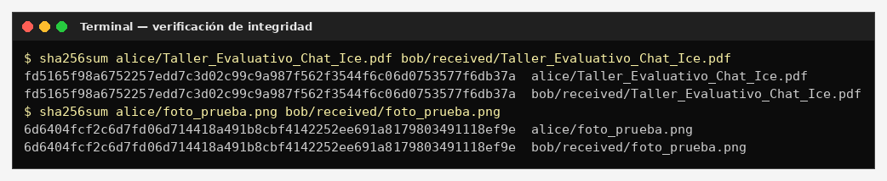

```text
fd5165f98a6752257edd7c3d02c99c9a987f562f3544f6c06d0753577f6db37a  alice/Taller_Evaluativo_Chat_Ice.pdf
fd5165f98a6752257edd7c3d02c99c9a987f562f3544f6c06d0753577f6db37a  bob/received/Taller_Evaluativo_Chat_Ice.pdf
6d6404fcf2c6d7fd06d714418a491b8cbf4142252ee691a8179803491118ef9e  alice/foto_prueba.png
6d6404fcf2c6d7fd06d714418a491b8cbf4142252ee691a8179803491118ef9e  bob/received/foto_prueba.png
```

los hashes son iguales byte a byte, o sea que no se perdió ni se dañó ningún chunk. En Windows se hace lo mismo con `certutil -hashfile <archivo> SHA256`.

### Prueba 5 — Llamada de voz 1 a 1 (RF-05)

Ahora Alice llama a Bob con `/call Bob`, a Bob le suena y contesta con `/accept`:

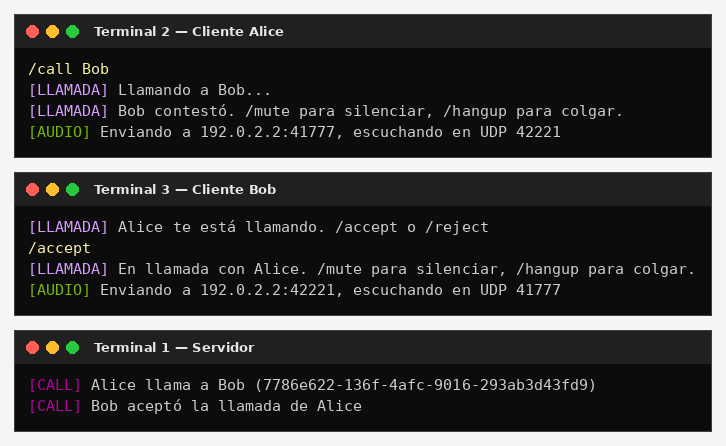

```text
--- Alice ---
/call Bob
[LLAMADA] Llamando a Bob...
[LLAMADA] Bob contestó. /mute para silenciar, /hangup para colgar.
[AUDIO] Enviando a 192.0.2.2:41777, escuchando en UDP 42221

--- Bob ---
[LLAMADA] Alice te está llamando. /accept o /reject
/accept
[LLAMADA] En llamada con Alice. /mute para silenciar, /hangup para colgar.
[AUDIO] Enviando a 192.0.2.2:42221, escuchando en UDP 41777

--- Server ---
[CALL] Alice llama a Bob (7786e622-136f-4afc-9016-293ab3d43fd9)
[CALL] Bob aceptó la llamada de Alice
```

acá hay dos canales distintos trabajando:

1. La **señalización** (llamar, sonar, contestar, colgar) va por Ice/TCP. `startCall` devuelve un `callId` (un UUID) que identifica la llamada, y el server avisa con los callbacks `onIncomingCall` y `onCallAccepted`.
2. El **audio** va por UDP directo entre los dos clientes, sin pasar por el server. Cada cliente abre un `DatagramSocket` en el puerto 0 (el sistema operativo le da uno libre) y le manda al server solo el puerto, con el host vacío. El server rellena la IP real de cada uno con la IP de su conexión TCP, y le pasa a cada uno la dirección del otro.

Por eso los puertos quedan cruzados: Alice escucha en el `42221` y Bob le manda a ese; Bob escucha en el `41777` y Alice le manda a ese. El audio es PCM de 16 kHz, 16 bits, mono, en paquetes de 20 ms (640 bytes, 50 paquetes por segundo). Usamos UDP porque en voz es mejor perder un paquete que esperar a que se reenvíe tarde.

### Prueba 6 — Usuario ocupado y mute

Mientras Alice y Bob están en llamada, Carlos intenta llamar a Bob, y Alice prueba el `/mute`:

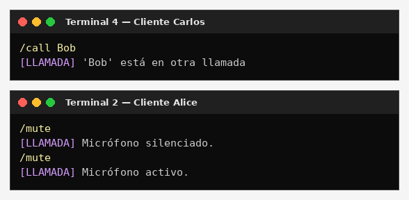

```text
--- Carlos ---
/call Bob
[LLAMADA] 'Bob' está en otra llamada

--- Alice ---
/mute
[LLAMADA] Micrófono silenciado.
/mute
[LLAMADA] Micrófono activo.
```

el server lleva un mapa de quién está ocupado y responde con la excepción `UserBusy`, así que la llamada de Carlos no interrumpe la que está en curso. Con `/mute` el micrófono se sigue leyendo pero esos paquetes no se mandan; así al quitar el mute no hay retraso acumulado.

### Prueba 7 — Colgar

Alice cuelga con `/hangup`:

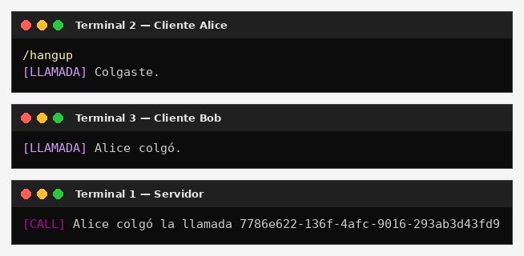

```text
--- Alice ---
/hangup
[LLAMADA] Colgaste.

--- Bob ---
[LLAMADA] Alice colgó.

--- Server ---
[CALL] Alice colgó la llamada 7786e622-136f-4afc-9016-293ab3d43fd9
```

el server borra la llamada, libera a los dos y le avisa a Bob con `onCallEnded`. Cada cliente para el hilo que envía, el que recibe, y cierra el socket UDP, así que se liberan el micrófono, el parlante y el puerto.

### Prueba 8 — Rechazar una llamada

Ahora Carlos llama a Alice y ella la rechaza con `/reject`:

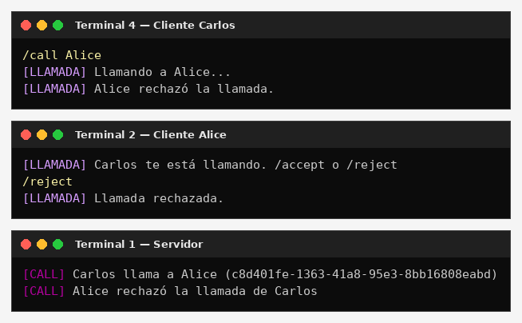

```text
--- Carlos ---
/call Alice
[LLAMADA] Llamando a Alice...
[LLAMADA] Alice rechazó la llamada.

--- Alice ---
[LLAMADA] Carlos te está llamando. /accept o /reject
/reject
[LLAMADA] Llamada rechazada.

--- Server ---
[CALL] Carlos llama a Alice (c8d401fe-1363-41a8-95e3-8bb16808eabd)
[CALL] Alice rechazó la llamada de Carlos
```

a Carlos le llega `onCallRejected` y vuelve a quedar libre para llamar a otra persona.

### Prueba 9 — Desconexión abrupta en plena llamada

Esta es la prueba más pesada. Carlos llama a Bob, Bob contesta, y en plena llamada cerramos la terminal de Bob a la fuerza con `Ctrl+C`, sin que haga `/hangup` ni `/quit`:

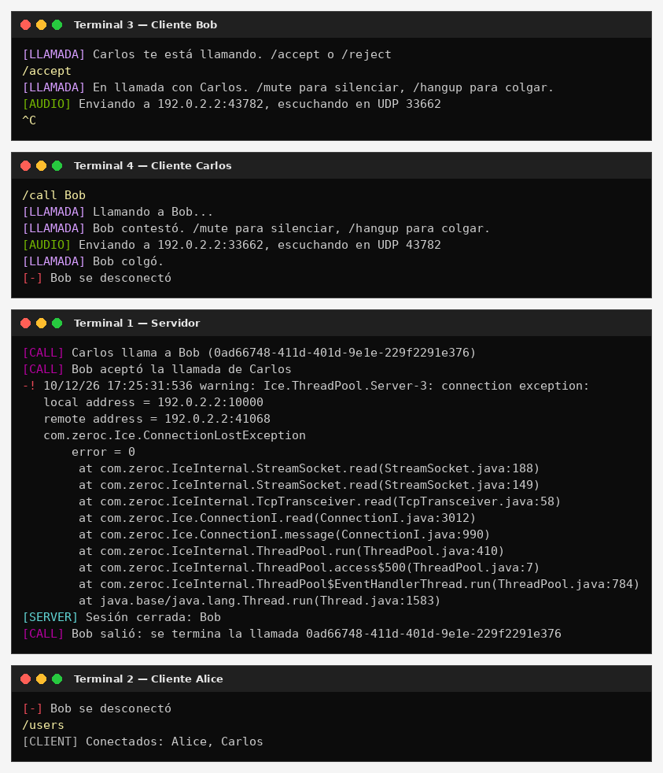

```text
--- Bob ---
[LLAMADA] Carlos te está llamando. /accept o /reject
/accept
[LLAMADA] En llamada con Carlos. /mute para silenciar, /hangup para colgar.
[AUDIO] Enviando a 192.0.2.2:43782, escuchando en UDP 33662
^C

--- Carlos ---
[LLAMADA] Bob contestó. /mute para silenciar, /hangup para colgar.
[AUDIO] Enviando a 192.0.2.2:33662, escuchando en UDP 43782
[LLAMADA] Bob colgó.
[-] Bob se desconectó

--- Server ---
-! 10/12/26 17:25:31:536 warning: Ice.ThreadPool.Server-3: connection exception:
   ...
   com.zeroc.Ice.ConnectionLostException
   ...
[SERVER] Sesión cerrada: Bob
[CALL] Bob salió: se termina la llamada 0ad66748-411d-401d-9e1e-229f2291e376

--- Alice ---
[-] Bob se desconectó
/users
[CLIENT] Conectados: Alice, Carlos
```

el server se dio cuenta de inmediato porque la conexión TCP de Bob se cerró. El texto largo que sale en el server **no es un error del programa**: es el aviso que imprime Ice porque en `config.server` tenemos `Ice.Warn.Connections=1`, y nos sirve para ver que la conexión se perdió (`ConnectionLostException`). Después de eso pasa lo importante:

1. El `SessionRegistry` cierra la sesión de Bob y les avisa a todos que salió (`[-] Bob se desconectó`).
2. Como el `CallService` está registrado como listener de logout, se entera de que Bob tenía una llamada abierta, la termina y le avisa a Carlos con `onCallEnded`. Sin esto Carlos se quedaría "en llamada" con alguien que ya no existe y no podría volver a llamar.
3. El `/users` de Alice ya solo muestra a Alice y Carlos, o sea que el estado del server quedó limpio.

Si un cliente se queda colgado sin cerrar la conexión (por ejemplo se va el wifi), el server también lo saca: el cliente manda heartbeats cada 10 s, y si el server no recibe nada en 30 s cierra esa conexión y pasa por este mismo camino.

### Prueba 10 — Tolerancia a fallos: se cae el server

Por último vamos a la terminal del server y lo cerramos con `Ctrl+C`, y desde Alice intentamos mandar un mensaje:

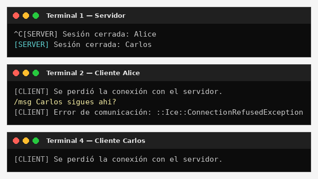

```text
--- Server ---
^C[SERVER] Sesión cerrada: Alice
[SERVER] Sesión cerrada: Carlos

--- Alice ---
[CLIENT] Se perdió la conexión con el servidor.
/msg Carlos sigues ahi?
[CLIENT] Error de comunicación: ::Ice::ConnectionRefusedException

--- Carlos ---
[CLIENT] Se perdió la conexión con el servidor.
```

los clientes reaccionan en dos capas sin reventar:

1. El **close callback** de la conexión detecta la caída apenas el server se cierra e imprime `[CLIENT] Se perdió la conexión con el servidor.`, sin que el usuario tenga que escribir nada.
2. Cuando Alice intenta mandar el mensaje, Ice intenta reconectar al puerto 10000, que ya no acepta conexiones, y el sistema operativo responde **"connection refused"**. Ice lo entrega como `ConnectionRefusedException`, el cliente la captura y muestra un error controlado en vez de un stacktrace.

### Prueba en dos PCs — audio UDP real

Las pruebas de arriba se hicieron con los tres clientes en el mismo equipo. Para comprobar que el audio sí viaja por la red entre equipos distintos, probamos con dos PCs en la misma red wifi: el PC A con IP `192.168.1.16` y el PC B con IP `192.168.1.14`. Primero hicimos ping del PC A al B para ver que se ven:

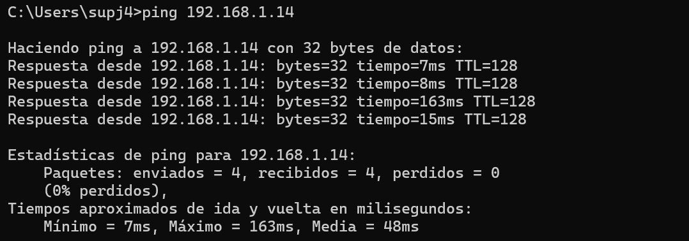

```text
Haciendo ping a 192.168.1.14 con 32 bytes de datos:
Respuesta desde 192.168.1.14: bytes=32 tiempo=7ms TTL=128
...
Paquetes: enviados = 4, recibidos = 4, perdidos = 0
```

y después corrimos la prueba aislada de audio (`AudioTest`) en los dos PCs al tiempo, cada uno mandándole al otro por el puerto UDP 5000:

`.\gradlew :client:runAudioTest -PaudioArgs="192.168.1.16 5000 5000"`

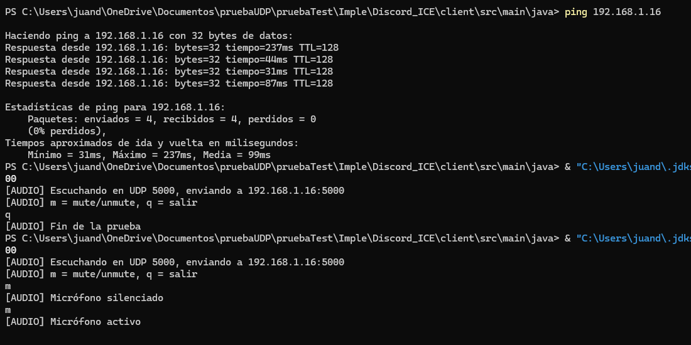

```text
[AUDIO] Escuchando en UDP 5000, enviando a 192.168.1.16:5000
[AUDIO] m = mute/unmute, q = salir
m
[AUDIO] Micrófono silenciado
m
[AUDIO] Micrófono activo
```

se escuchó la voz de un PC en el otro, y el mute funcionó. Algo que aprendimos acá es que con el firewall de Windows activo y la red marcada como **pública**, los paquetes UDP no entraban. La forma correcta de hacerlo es dejar la red como **privada**, el firewall encendido y permitir Java cuando Windows lo pregunte, en vez de apagar el firewall.

Con esto queda demostrado que el chat multimedia con ZeroC Ice funciona correctamente en lo que llevamos: inicio de sesión y presencia en tiempo real con callbacks, mensajes privados, envío de archivos por chunks sin pérdida (verificado con SHA-256), llamadas 1 a 1 con señalización por Ice y audio por UDP, y el manejo de los casos de falla (usuario ocupado, rechazo, desconexión abrupta y caída del server) sin que ningún proceso se caiga.

# Preguntas Teoricas Compunet1


#### Preguntas


##### 1. Arquitectura Hibrida TCP/UDP: ¿Cuales son las razones tecnicas fundamentales para diseñar una arquitectura hibrida donde el control, el chat de texto y la transferencia de archivos corren sobre ZeroC Ice (TCP), mientras que el flujo de voz corre directamente sobre UDP? ¿Que consecuencias acusticas y de rendimiento ocurririan si la voz se transmitiera sobre Ice/TCP bajo condiciones de fluctuacion de red (jitter) o perdida de paquetes?

##### R//

Se usa una arquitectura híbrida porque no todos los datos necesitan lo mismo. En el chat y los archivos es importante que la información llegue completa y en orden. En cambio, para una llamada de voz es más importante que el audio llegue a tiempo.

¿Por qué usar Ice sobre TCP para el control, el chat y los archivos?

- Entrega confiable: TCP se encarga de que los datos lleguen en orden y retransmite los que se pierden. Esto es importante para los mensajes, los comandos y los archivos.
- Funciones de Ice: Ice permite hacer llamadas remotas usando las interfaces definidas en el proyecto. También maneja la serialización de los datos y permite usar callbacks sin tener que implementar todo desde cero.
- La demora es tolerable: Si un mensaje de chat se demora un poco, normalmente no afecta mucho la experiencia. En cambio, recibir un archivo incompleto sí sería un problema.
- Control de congestión: TCP ajusta el envío de datos según las condiciones de la red, algo útil cuando se transfieren archivos grandes.

¿Por qué usar UDP para la voz?

- El audio debe llegar a tiempo: En nuestro caso, cada paquete contiene 640 bytes, equivalentes a 20 ms de audio PCM a 16 kHz, con muestras de 16 bits y un canal, según AudioConfig. Si llega demasiado tarde, puede que ya no sirva para reproducirlo.
- Es preferible perder un paquete a esperar demasiado: La pérdida ocasional de un paquete puede causar un pequeño corte, pero esperar a que se retransmita puede generar una pausa más larga.
- Menos sobrecarga: UDP tiene una cabecera de 8 bytes y no necesita establecer una conexión ni gestionar confirmaciones y retransmisiones como TCP.
- La aplicación puede manejar los paquetes tardíos: El receptor puede descartar un paquete que llegue tarde o usar un buffer para reducir los efectos de las variaciones en el tiempo de llegada.

Ice sigue siendo útil para configurar la llamada, por ejemplo, para intercambiar la dirección IP y el puerto UDP de cada cliente. Los datos de audio, en cambio, se envían directamente por UDP usando DatagramSocket y las clases CallManager, AudioSender y AudioReceiver.

¿Qué pasaría si la voz se enviara por Ice/TCP?

1. Bloqueo de paquetes: Si se pierde un segmento TCP, los datos que vienen después pueden quedar esperando hasta que se retransmita el segmento perdido. Esto puede detener temporalmente la reproducción del audio.
2. Más latencia: Las retransmisiones pueden aumentar el retraso. Como la voz debe reproducirse de forma continua, el audio atrasado puede acumularse y dejar de ser útil.
3. Problemas de sonido: Se podrían escuchar silencios, cortes o audio entrecortado. También podrían llegar varios paquetes juntos después de una pausa, lo que afectaría el ritmo de la conversación.
4. Cambios en el envío por congestión: Cuando detecta pérdidas, TCP puede reducir la velocidad de envío. Esto dificulta mantener un flujo constante de audio. Además, ciertas configuraciones, como el algoritmo de Nagle, pueden añadir demora si agrupan mensajes pequeños.
5. Más trabajo para Ice: Enviar cada bloque de audio como una llamada remota agrega trabajo de serialización y despacho. También puede competir por los recursos del servidor con los mensajes de chat y las transferencias de archivos.

Basicamente, TCP es adecuado cuando importa que los datos lleguen completos y en orden. Para la voz importa más recibirlos a tiempo, por eso se utiliza UDP para el audio y Ice/TCP para el control, el chat y los archivos.

##### 2. Manejo de Buffer y Chunking en Ice: Si un usuario intenta transferir un video de 80 MB mediante una unica llamada RPC pasando toda la secuencia de bytes en un parametro sequence<byte>, ¿que excepcion o comportamiento manifestara ZeroC Icepor defecto? Explique como la tecnica de fragmentacion en bloques resuelve este problema y que parametros de configuracion de Ice intervienen 

##### R//

¿Qué pasa por defecto?

Ice limita el tamaño máximo de un mensaje de protocolo con la propiedad Ice.MessageSizeMax, cuyo valor por defecto es 1024 KB (1 MB). Un sequence<byte> de 80 MB genera una petición de unos 80 MB más la cabecera Ice y la codificación del tamaño, es decir, unas 80 veces el límite.

- Cuando el runtime de Ice (normalmente el lado receptor, el servidor) lee la cabecera del mensaje y ve que el tamaño declarado supera Ice.MessageSizeMax, lanza Ice.MemoryLimitException (en Java, com.zeroc.Ice.MemoryLimitException) y cierra la conexión. La invocación nunca llega a despacharse al servant.
- El cliente que hizo la llamada normalmente no recibe la MemoryLimitException directamente: ve que la conexión se cayó a mitad de la petición y obtiene una Ice.ConnectionLostException (o una UnknownLocalException, según la versión). Con Ice.Warn.Connections=1, el servidor deja la advertencia en el log.
- Antes de que salte el error, el cliente ya gastó memoria y red: tuvo que cargar el archivo entero en un byte[] de 80 MB y otro buffer igual para el marshalling (riesgo de OutOfMemoryError en JVMs con poco heap), y empezó a mandar datos que después se descartan.
- Aunque se subiera el límite, el problema de fondo seguiría ahí: una sola llamada monopoliza la conexión TCP compartida (los mensajes de chat y los callbacks quedan esperando detrás), un hilo del thread pool queda ocupado mientras se reciben 80 MB, la llamada puede superar el timeout y, si falla al 99 %, hay que reenviar todo. Además, el servidor tendría que reenviar esos 80 MB a cada destinatario por callback, y el límite también aplica a esas conexiones.

¿Cómo lo resuelve la fragmentación en bloques (chunking)?

La idea es dividir el archivo en bloques pequeños y mandar una invocación por bloque, cada una muy por debajo de Ice.MessageSizeMax. Así está modelado en nuestro proyecto (Chat.ice):

    struct FileChunk {
        string transferId;   // UUID que agrupa los chunks del mismo archivo
        ...
        int chunkIndex;      // 0 .. totalChunks-1
        int totalChunks;
        ByteSeq data;        // 32–64 KB, por debajo de Ice.MessageSizeMax
    };
    void sendFileChunkToUser(string nickname, string to, FileChunk chunk);
    void sendFileChunkToRoom(string nickname, string room, FileChunk chunk);

Funcionamiento:

1. El emisor lee el archivo como stream (FileInputStream/RandomAccessFile) en bloques de N KB (por ejemplo 64 KB). Calcula totalChunks = ceil(tamaño / N) (80 MB / 64 KB = 1280 chunks), genera un transferId y envía cada bloque con su chunkIndex. Nunca tiene el archivo completo en memoria.
2. El servidor recibe cada chunk como una invocación normal y lo reenvía al destinatario o a la sala con onFileChunk(...). Cada mensaje (cliente→servidor y servidor→cliente) mide unos 64 KB, así que nunca se acerca al límite.
3. El receptor agrupa los chunks por transferId, los escribe en la posición que indica chunkIndex (offset = índice × N) y, cuando tiene los totalChunks, cierra el archivo. Opcionalmente puede comprobar un hash.

Ventajas:

- No hay MemoryLimitException y no hace falta tocar la configuración por defecto.
- Memoria acotada: emisor, servidor y receptor solo tienen uno o pocos bloques en memoria a la vez.
- Intercalado (multiplexación): entre chunk y chunk pueden pasar por la misma conexión mensajes de chat, señalización de llamadas u otros callbacks, así que la aplicación sigue respondiendo.
- Progreso y reanudación: se puede mostrar el porcentaje de avance, reintentar solo el chunk que falló y reanudar una transferencia interrumpida desde el último índice confirmado.
- Control de flujo: si el emisor hace llamadas twoway (o espera el futuro de ...Async con una ventana limitada de chunks en vuelo), no satura al servidor. TCP y la respuesta de Ice actúan como backpressure.
- Cada invocación es corta, así que no supera los timeouts y no ocupa un hilo durante mucho tiempo.

Parámetros de configuración de Ice que intervienen

| Propiedad | Para qué sirve |
|---|---|
| Ice.MessageSizeMax | Tamaño máximo (en KB) de un mensaje enviado o recibido. Por defecto 1024; 0 lo deja sin límite (no recomendado, porque abre la puerta a ataques de memoria). Debe estar alineado en cliente y servidor, porque el que recibe es el que valida. En nuestro proyecto aparece comentado (#Ice.MessageSizeMax=1024) en config.client y config.server, así que se usa el valor por defecto, y el tamaño del chunk se elige por debajo de él. |
| Ice.Warn.Connections | Si vale 1, registra en el log por qué se cerró una conexión (por ejemplo, por exceder el tamaño). Útil para diagnosticar. |
| Timeouts del endpoint (-t en Endpoints/proxy), Ice.Override.Timeout, Ice.Connection.ConnectTimeout / Ice.Override.ConnectTimeout (y en Ice 3.8 Ice.Connection.InactivityTimeout) | Una sola petición enorme puede superar el timeout y hacer que se aborte la conexión. Con chunks pequeños, cada invocación termina rápido. |
| Ice.ACM.* (Ice.ACM.Timeout, Ice.ACM.Close, Ice.ACM.Heartbeat) | Gestión activa de conexiones y heartbeats. Evita que se cierre por inactividad una conexión que se usa para callbacks o transferencias largas. |
| Ice.ThreadPool.Server.Size / SizeMax y Ice.ThreadPool.Client.Size / SizeMax | Número de hilos que despachan invocaciones y callbacks. Con chunking, ningún hilo queda bloqueado mucho tiempo y el resto de operaciones sigue atendiéndose. |
| Ice.TCP.SndSize / Ice.TCP.RcvSize | Tamaño de los buffers del socket TCP. Afecta al throughput de los chunks. |
| Ice.Override.Compress (y -z en el endpoint) | Activa compresión bzip2 de los mensajes. Hay que tener en cuenta que Ice.MessageSizeMax se aplica al tamaño sin comprimir, así que comprimir no evita la excepción. Para video, que ya viene comprimido, casi no aporta nada. |
| Ice.BatchAutoFlushSize | Si los chunks se envían como invocaciones oneway en batch, controla cuándo se vacía el lote. No debe superar Ice.MessageSizeMax. |

Subir Ice.MessageSizeMax a más de 80 MB "funcionaría", pero solo traslada el problema (memoria, bloqueo de la conexión, timeouts, ningún progreso ni reanudación). La solución correcta es fragmentar en bloques de 32–64 KB con metadatos (transferId, chunkIndex, totalChunks) que permitan reensamblar el archivo en el receptor.


## 4. **Transparencia y Callbacks en Ice:** Describa el ciclo de vida y la configuración de adaptadores de objetos requerida en el cliente para permitir que el servidor Ice invoque métodos de retorno (callbacks) sobre él. ¿Qué papel juegan los proxies directos vs indirectos en este flujo?

R// Para responder esta pregunta primero hay que entender qué es un callback y por qué lo necesitamos. Normalmente en Ice el **cliente** es el que llama al **servidor**: el cliente tiene un proxy del servidor y le invoca métodos como `login(...)` o `sendPrivate(...)`. Un callback es justo lo contrario: es cuando el **servidor** necesita invocar métodos que viven en el **cliente**, por ejemplo para avisarle que le llegó un mensaje privado (`onPrivateMessage`), que alguien se conectó (`onUserJoined`), que lo están llamando (`onIncomingCall`) o que le llegó un pedazo de un archivo (`onFileChunk`).

En nuestro chat esto es indispensable, porque sin callbacks el cliente tendría que estar preguntándole al servidor cada cierto tiempo si hay algo nuevo (polling), que es lo que hacíamos en el taller anterior con `getPendingMessages` cada 500 ms. Con callbacks el servidor **empuja** los eventos al cliente apenas ocurren.

Para que el servidor pueda invocar métodos sobre el cliente, el cliente tiene que comportarse, en cierta parte, **también como un servidor**: necesita un **object adapter** que reciba esas llamadas entrantes y las despache a un objeto suyo, que en Ice se llama **servant**. En nuestro proyecto ese servant es la clase `ClientCallbackI`, que implementa la interfaz `ClientCallback` definida en el contrato `Chat.ice`:

```
interface ClientCallback {
    void onUserJoined(string nickname);
    void onUserLeft(string nickname);
    void onPrivateMessage(ChatMessage msg);
    void onRoomMessage(ChatMessage msg);
    void onFileChunk(string sender, string room, FileChunk chunk);
    void onIncomingCall(string callId, string caller, VoiceEndpoint callerEndpoint);
    ...
};
```

Vale aclarar que `ClientCallbackI` es el que recibe **todos** los avisos del servidor (presencia, mensajes, archivos y llamadas). Para no meter toda la lógica en una sola clase, `ClientCallbackI` delega en clases de apoyo: la lógica de llamadas la maneja `CallManager` y el rearmado de archivos lo maneja `FileAssembler`.

### 4A) Ciclo de vida del adaptador en el cliente

El ciclo de vida completo se puede ver en nuestro `ClientMain`, y pasa por los siguientes pasos:

|#|Código en el cliente / servidor|Qué hace|
|---|---|---|
|1|`Util.initialize(initData)`|Crea el `Communicator`, que es el núcleo de Ice en el cliente|
|2|`communicator.createObjectAdapter("")`|Crea un object adapter **sin nombre y sin endpoints**: el cliente **no abre ningún puerto** para escuchar|
|3|`adapter.addWithUUID(new ClientCallbackI(calls, files))`|Registra el servant con una identidad única (UUID) y devuelve el **proxy** que apunta a él|
|4|`adapter.activate()`|El adapter empieza a despachar llamadas entrantes|
|5|`server.ice_getConnection().setAdapter(adapter)`|Asocia el adapter a la conexión TCP que el cliente **ya abrió** hacia el servidor (conexión bidireccional)|
|6|`server.login(nickname, callback)`|Le entrega al servidor el nickname y el proxy del callback|
|7|En el servidor: `cb.ice_fixed(current.con)`|El servidor amarra ese proxy a la conexión por la que llegó y lo guarda en su registro de sesiones|
|8|`connection.setACM(... HeartbeatAlways)`|El cliente manda heartbeats periódicos para que el servidor sepa que sigue vivo aunque no escriba nada|
|9|`/logout`, `/quit` o una caída|Se cierra la sesión, se destruye el `Communicator` (lo que desactiva el adapter) y el servidor detecta el cierre de la conexión y elimina la sesión y el proxy guardado|

En código, la parte central del cliente se ve así:

```java
// 2. adapter sin endpoints: no escucha en ningún puerto
ObjectAdapter adapter = communicator.createObjectAdapter("");

// 3. se registra el servant y se obtiene su proxy
ClientCallbackPrx callback = ClientCallbackPrx.uncheckedCast(
        adapter.addWithUUID(new ClientCallbackI(calls, files)));

// 4. empieza a despachar
adapter.activate();

// 5. conexión bidireccional: las llamadas del servidor llegan por ESTA conexión
Connection connection = server.ice_getConnection();
connection.setAdapter(adapter);

// 6. se le pasa el proxy al servidor
server.login(nickname, callback);
```

Y del lado del servidor (`SessionRegistry`):

```java
// 7. el proxy se amarra a la conexión por la que llegó el login
ClientCallbackPrx target = cb.ice_fixed(current.con);
```

Todo el ciclo de vida se ve de la siguiente manera:

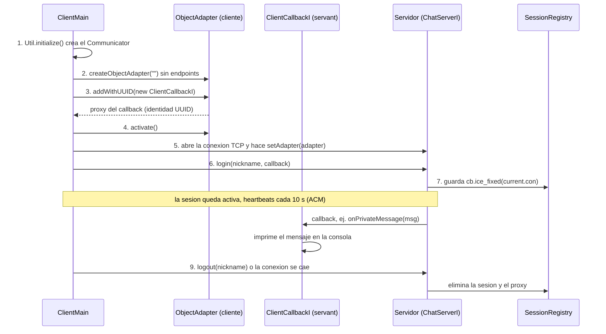

### 4B) ¿Por qué una conexión bidireccional y no un adapter con puerto propio?

Aquí es importante aclarar algo: el adapter del cliente **no abre ningún puerto**, ni siquiera uno que asigne el sistema operativo. Lo que hace es reutilizar la misma conexión TCP que el cliente abrió hacia el servidor en el puerto 10000. A esto se le llama **conexión bidireccional**: el cliente abre la conexión una sola vez, y por ella viajan tanto sus peticiones al servidor como los callbacks del servidor hacia él.

La alternativa sería darle endpoints al adapter del cliente, por ejemplo poniendo en `config.client` algo como `Callback.Endpoints=tcp -p 5000`. Así el cliente escucharía en el puerto 5000, y el servidor tendría que **abrir una conexión nueva hacia el cliente** cada vez que quiera hacerle un callback. Eso trae varios problemas:

|Aspecto|Adapter con endpoints (puerto propio)|Conexión bidireccional (nuestra elección)|
|---|---|---|
|Puertos abiertos en el cliente|Sí, uno por cliente|Ninguno|
|Quién inicia la conexión del callback|El servidor, hacia el cliente|Nadie: se reutiliza la que abrió el cliente|
|Cliente detrás de NAT o firewall|Falla, el servidor no puede llegar al cliente|Funciona, porque la conexión sale desde el cliente|
|Configuración extra|Endpoints, IP pública del cliente, reglas de firewall|Solo `setAdapter` en el cliente y `ice_fixed` en el servidor|
|Conexiones TCP por cliente|Dos (ida y vuelta)|Una sola|

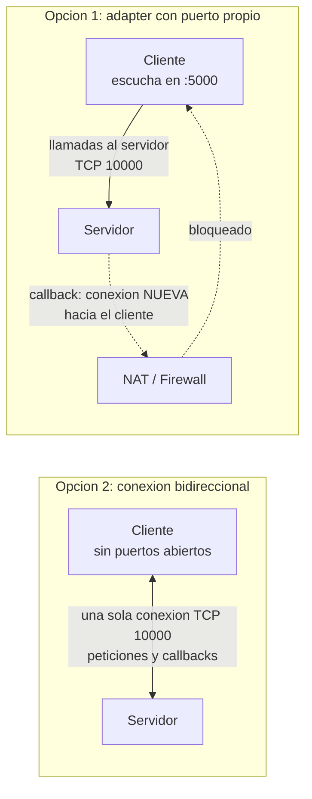

Esto es especialmente importante en la red de la universidad, donde los equipos suelen estar detrás de NAT o con el firewall activo: con la conexión bidireccional el cliente no necesita ser alcanzable desde afuera, porque todo viaja por la conexión que él mismo abrió.

Un detalle adicional es que, como el servidor depende de esa única conexión para llegarle al cliente, necesita saber si sigue viva. Por eso el cliente manda **heartbeats** cada 10 segundos (ACM con `HeartbeatAlways`) y el servidor cierra la conexión si pasa un tiempo sin recibir nada. Cuando la conexión se cierra, el servidor ejecuta su `closeCallback`, elimina la sesión y le avisa a los demás con `onUserLeft`. Así es como detectamos las desconexiones abruptas del RF-01.

### 4C) Proxies directos vs indirectos

Un **proxy** es la referencia que usa Ice para invocar un objeto remoto como si fuera local. Lo que cambia entre un tipo y otro es **cómo se encuentra la dirección** del objeto:

|Tipo de proxy|Qué contiene|Ejemplo|Cómo se resuelve la dirección|
|---|---|---|---|
|**Directo**|Identidad + endpoints (protocolo, host y puerto)|`ChatServer:tcp -h localhost -p 10000`|Ya viene escrita en el proxy, el cliente se conecta directo|
|**Indirecto**|Solo identidad, o identidad + adapter|`ChatServer` o `ChatServer@ChatAdapter`|En tiempo de ejecución, consultando un **Locator** (por ejemplo IceGrid)|
|**Fijo** (`ice_fixed`)|Identidad + una conexión ya existente|el proxy del callback en el servidor|No se resuelve: usa siempre esa conexión|

En nuestro proyecto:

1. **El cliente usa un proxy directo para llegar al servidor.** Está definido en `config.client` como `ChatServer.Proxy=ChatServer:tcp -h localhost -p 10000`, y con `-Pserver=<ip>` lo cambiamos para la demo en red. Es simple y no necesita infraestructura extra, pero si el servidor cambia de IP o de puerto hay que avisarle a cada cliente.
2. **Un proxy indirecto daría transparencia de ubicación.** Si usáramos IceGrid, el cliente solo conocería `ChatServer@ChatAdapter`, y el Locator le diría en cada momento dónde está el servidor. Así el servidor podría moverse de máquina sin tocar a los clientes. No lo usamos porque para el alcance del taller (una sola instancia del servidor en la red local) no hace falta.
3. **El proxy del callback no es ni directo ni indirecto.** Como el adapter del cliente **no tiene endpoints**, el proxy que el cliente le manda al servidor en el `login` no trae ninguna dirección a la cual conectarse, y tampoco se puede resolver con un Locator porque no usamos uno. Por eso el servidor lo convierte en un **proxy fijo** con `ice_fixed(current.con)`: lo amarra a la conexión por la que llegó el `login`. Desde ese momento, todas las invocaciones de callback hacia ese cliente viajan por esa misma conexión.

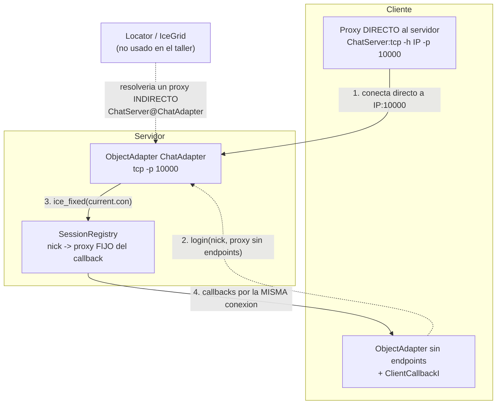

### 4D) ¿Dónde está la transparencia?

La transparencia de Ice consiste en que, gracias a los proxies, ninguno de los dos lados tiene que preocuparse por la red. Cuando el cliente hace `server.login(...)` y cuando el servidor hace `cb.onIncomingCall(...)`, los dos lo escriben **como si fueran llamadas a métodos locales**. Por debajo, el runtime de Ice:

1. Serializa la operación y sus parámetros en binario (IceP).
2. Los envía por la conexión TCP.
3. Del otro lado, el object adapter recibe la petición, busca el servant por su identidad y la despacha a uno de los hilos de su ThreadPool.
4. Si la operación devuelve algo o lanza una excepción de Slice (por ejemplo `UserNotFound`), la devuelve por el mismo camino.

Por ejemplo, cuando un usuario A le manda un mensaje privado a B, el flujo completo se ve así:

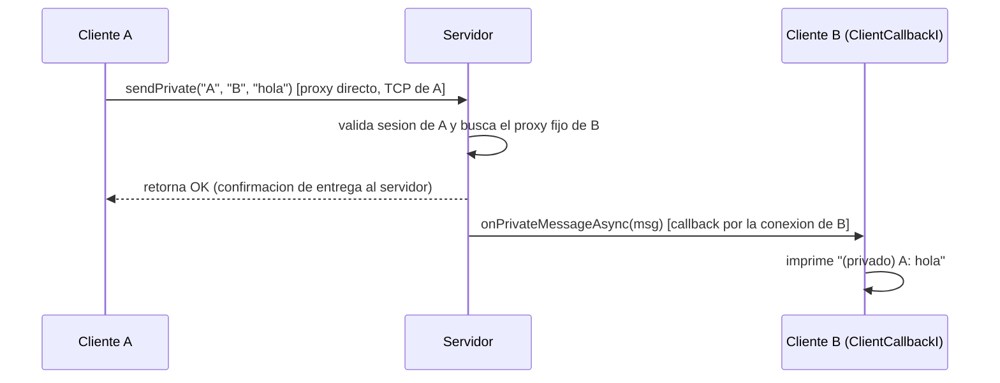

Lo importante de este diagrama es que A nunca conoce la dirección de B: A solo habla con el servidor, y el servidor le llega a B por la conexión que B abrió al hacer login. Las llamadas al callback son **asíncronas** (`...Async`) para que el servidor no se quede bloqueado esperando a un cliente lento, y si un cliente ya no responde, el servidor lo detecta, lo saca del registro y le avisa a los demás.

En resumen, el ciclo de vida del callback en el cliente es: **crear el Communicator → crear un adapter sin endpoints → registrar el servant `ClientCallbackI` → activar el adapter → asociarlo a la conexión con el servidor → entregar el proxy en el `login` → recibir callbacks durante la sesión → destruir todo al salir**. El cliente llega al servidor con un **proxy directo**, un **proxy indirecto** daría transparencia de ubicación usando un Locator, y el servidor le llega al cliente con un **proxy fijo** amarrado a la conexión bidireccional, lo que permite los callbacks sin abrir puertos en el cliente y aunque esté detrás de un NAT o firewall.


## Bitacora de IA 

el modelo o el agente de IA que utilizamos fue Claude Pro y ChatGTP con el modelo Opus/sonnet esfuerzo alto; antes que nada se le envio el pdf del enunciado del taller, para que entendiera el objectivo del proyecto como tal, ademas, pues me base en el para hacer la estructura de los subproyectos, cliente, server y common (ICE), ya que es algo que no habia hecho, le pedi ayuda en lo de grawdle, pues para saber si estaban bien sus respuestas leimos el enunciado para ver si cumplia con los requisitos de la rubrica; se hizo un esqueleto para que todos podamos avanzar en conjunto sin conflictos ademas de una ayuda para el contrato de ICE, despues se hizo los RF'S cada uno en plena colaboracion siguiendo los parametros del enunciado

el uso de IA en mi proyecto fue muy colaborativo, fue de trabajar a la par, y muestra de eso fue como se hizo las respuestas del cuestionario.
reflexión de Emmanuel Muñoz Bustamante:
Usé la IA principalmente para destrabar errores de compilación con explicación y para pensar el diseño antes de escribir código, pidiéndole explícitamente que no me diera soluciones completas de entrada sino que me hiciera preguntas o me explicara el porqué (por ejemplo, antes de armar GroupCallRegistry le pedí que me explicara los pasos en vez de darme el código de una). También la usé como revisora de un esqueleto que escribí yo, y como revisora de una respuesta teórica que redacté yo mismo (dos veces), nunca pedí que la escribiera desde cero.
El mayor valor estuvo en que la IA conectaba decisiones ya tomadas por mis compañeros en otras partes del código (RF-05, RF-03) con lo que yo necesitaba para RF-06, en vez de proponer soluciones genéricas que no calzaran con el resto del proyecto — para eso tuve que compartirle el código real de CallService, RoomRegister, SessionRegistry, etc., en lugar de pedirle que inventara desde cero.

Reflexion Juan Diego: Los modelos y agentes de IA que utilicé durante el desarrollo del taller fueron Claude Pro y ChatGPT GO, con modelos de la familia Sonnet y Opus para claude , utilizando un nivel de esfuerzo medio y GPT-6. Inicialmente, compartí el PDF del enunciado para que las herramientas entendieran el objetivo del proyecto y los requisitos establecidos en la rúbrica. A partir de esto, utilicé la IA como apoyo para comprender la estructura de los subproyectos client, server y common, así como para configurar Gradle y trabajar con el contrato ICE, mi parte del proyecto se centró principalmente en los requerimientos funcionales RF-01 y RF-02. Para desarrollarlos, utilicé la IA como apoyo para revisar la implementación, resolver errores y comprender cómo debían interactuar las diferentes partes del sistema sin pedirle explicitamente la respuesta sino que me sirviera como mentor y acompañante durante el proceso.

El uso de la IA en mi parte del proyecto fue principalmente colaborativo e iterativo, trabajando a la par con la herramienta en lugar de pedirle que desarrollara todo desde cero. Me resultó especialmente útil para entender errores que aparecían durante la implementación y para relacionar el funcionamiento de los requerimientos con la estructura general del sistema. Sin embargo, fue importante revisar las respuestas, probar las soluciones y comprobar que realmente cumplieran con los requisitos del taller, ya que no todas las sugerencias podían aplicarse directamente a nuestro proyecto